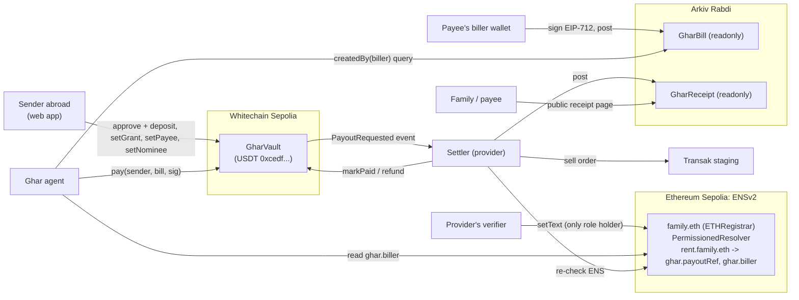

# Ghar: project context

The one document to read before working on Ghar, for developers and coding agents alike. It covers what the product is, how it is built, exactly which Whitechain, ENS and Arkiv features it uses, how that maps to the ETHGlobal Mumbai prize tracks, and what is still missing.

State described: `main` at `f78379c` plus the uncommitted working-tree changes of 6 Nov 2026 (see [Current state](#11-current-state)).

---

## 1. The idea in one paragraph

People working abroad are often paid in USDT, while the family bills they cover at home (rent, school fees, clinic visits) are owed in local currency to bank accounts. In Ghar the sender funds a vault once and sets caps. An AI agent then pays incoming bills, and the money can only reach accounts that a licensed payout provider has verified. Three guarantees are enforced onchain, not by our servers:

1. **Verified accounts only.** Funds only reach the payout account the provider verified, which lives in an ENS record only the provider can write. A "we changed our bank account, pay here" message can't redirect money.
2. **Only real bills.** A bill must be posted to Arkiv by the payee's registered biller wallet and carry that wallet's EIP-712 signature. It can be paid once, and not after its due date.
3. **Within the sender's rules.** Every payment stays inside the agent grant and the per-payee cap the sender set. If the sender goes silent, a nominee can take over the balance.

Each technology has one job:

| Layer | Technology | Holds |
| --- | --- | --- |
| Money and rules | **Whitechain** (Sepolia, chain 1874) | USDT, balances, caps, grants, escrowed payouts, nominee timer |
| Who may be paid | **ENSv2** (Ethereum Sepolia) | The payee book: payout reference and biller wallet per payee |
| Bills and receipts | **Arkiv** (Rabdi, chain 7794095) | Signed bills (public inbox) and the provider's receipts |
| Decisions | Ghar agent (Node) | Reads Arkiv and ENS, applies rules plus an AI check, calls the vault |
| Fiat leg | Settler and Transak staging | Pays the payee in fiat, settles on the vault, writes the receipt |

---

## 2. Architecture



### Repository layout

```
contracts/          GharVault.sol, Foundry tests (63), Deploy script, broadcast logs for chain 1874
packages/shared/    Chains, addresses, vault ABI (generated), shared types
packages/ens/       Payee names, ENS record reads and writes, setup/set-payee/add-to-vault scripts
packages/arkiv/     Arkiv schemas, bill signing and checks, reads, guarded writes, post/read scripts
apps/agent/         agent.ts (bills to vault), settler.ts (vault to fiat to receipt), decide, AI reviewer
apps/web/           Next.js 16 app: landing page, vault screens, bill inbox, public receipts
arkiv/              Arkiv prize docs: schema, friction, reach, why-arkiv, how-you-use-arkiv
ghar-payout-spike/  Earlier standalone payout prototype. Only adapter/transak.mjs is still used (by the settler)
docs/               Design reconstruction notes for the landing page (untracked)
```

TypeScript runs directly on Node 22.10+ (type stripping), with no build step for the packages. Everything uses `viem`. The web app uses `wagmi` and an injected wallet.

### Wallet roles

| Role | Does | On testnet |
| --- | --- | --- |
| Sender | Deposits USDT and sets grants, payees and nominee | `DEPLOYER_PRIVATE_KEY` plays the sender in scripts |
| Agent | Calls `pay()` within its grant | `AGENT_PRIVATE_KEY`, needs WBT for gas |
| Biller | Signs and posts bills for one payee | `0x14ce36ac40976c12b726AF5af5bfFFdAac14E0fd` |
| Provider and verifier | Immutable vault `provider`, the only ENS text writer, settles payouts and writes receipts | `0x19f4c0fcA7046cC29eF23139b30572F09a36e5f6` |
| Nominee | Withdraws after the sender is inactive for the set delay | Any address |
| Fake-bill demo | Shows that a non-biller's bill is ignored | `0x294dbec3E3b03c3195332f3308DA36ab83f4D44c` |

---

## 3. End-to-end flow

1. **Onboarding (once per payee).** The provider KYCs the payee off-chain. Its verifier writes `ghar.payoutRef` (a reference to the verified bank account, never the account itself) and `ghar.biller` (the payee's billing wallet) on `tag.family.eth`.
2. **Sender setup** (web app). `approve` and `deposit` USDT into the vault. `setGrant(agent, perPayment, perPeriod, period)`. `setPayee(namehash, biller, caps)`: the app reads the biller from ENS, so it is never typed in. Optionally `setNominee(nominee, delay)`.
3. **Billing.** The biller signs an EIP-712 `Bill{payee, invoiceRef, amount, dueDate}` bound to this vault and chain, then posts it to Arkiv as a `GharBill` from the same wallet. That makes `$creator` the biller.
4. **Agent tick** (every `POLL_SECONDS`, default 30). For each payee tag:
   - Read the ENS records, then query Arkiv for `GharBill` where `payee = name`, `dueDate >= now`, and `createdBy(ENS biller)`.
   - `checkBill`: payee matches, creator equals the ENS biller, not past due, digest recomputes, and the signature recovers to the biller.
   - `decide`: the vault's `billerOf` equals the ENS biller, and the amount is within `availableToAgent`, `availableToPayee` and `balanceOf`.
   - AI review (Groq, hold-only, see section 7).
   - `simulateContract` then `pay(sender, bill, signature)`.
5. **Vault `pay()`.** Charges the agent grant and the payee cap, checks the due date, refuses a used digest, verifies the signature against `billerOf` with `SignatureChecker`, moves the amount from the balance into a `Pending` payout, and emits `PayoutRequested`.
6. **Settler** (provider side). Watches `PayoutRequested`, skips anything not pending or already receipted, and re-checks from its own reads: the Arkiv bill from the vault's biller, the namehash match, the ENS records present and the biller unchanged. It then runs a Transak staging sell order (the payee confirms in the widget, and the settler sends the Sepolia ETH deposit automatically).
7. **Settlement.** `markPaid(digest, transakOrderId)` sends the USDT to the provider. A failure calls `refund(digest, reason)`, returning it to the sender's balance. If the provider does nothing for 1 day (`SETTLE_WINDOW`), anyone can call `reclaim(digest)`.
8. **Receipt.** The settler posts a `GharReceipt` to Arkiv (status, Whitechain tx, provider ref, fiat amount, payoutRef). The family opens `/receipt/<key>`, which needs no wallet.

Proof of one full live run on 6 Nov 2026 (bill, fake bill, `pay`, Transak order, `markPaid`, receipt) is in the README's "Live run" table.

---

## 4. Whitechain: exactly what we use

**Network.** Whitechain Sepolia, chain ID 1874, an EVM L2 on the OP Stack. We use `whitechainSepolia` from `viem/chains`. RPC `https://rpc.testnet.whitechain.io`, explorer `https://explorer.testnet.whitechain.io` (Blockscout). Gas is WBT from `https://faucet.testnet.whitechain.io`.

**Token.** The official test USDT `0xcedfB56113143d55b2358b8CFbB0dEB5Ad2f55a7`, which has 6 decimals. It is the only asset the vault holds, and every payment settles in it. We use standard ERC-20 `approve` plus `transferFrom` (via `deposit`) and `transfer`. The token also supports EIP-3009 `transferWithAuthorization`, but **we do not use it yet**.

**Contract.** `GharVault` v2 at `0x707447BCDD25651B0313c3542BB1a17fF2e1d29E`, deployed in block 12,375,263 on 6 Nov 2026 with `depositWithAuthorization`, and verified on the explorer (14:40 UTC, after its verification service came back). v1 at `0xA855E5b5152F7C7c824dc5c8EF034696a65587Ae` (block 12,351,281) ran the first live flow and is superseded; its balance was withdrawn. Built with Solidity 0.8.30, EVM `prague`, and OpenZeppelin `SafeERC20`, `ReentrancyGuard`, `EIP712` and `SignatureChecker`.

| Feature | Functions | Notes |
| --- | --- | --- |
| Isolated per-sender balances | `deposit`, `withdraw`, `balanceOf` | Only the sender funds or withdraws their own balance |
| Agent spending grants | `setGrant`, `revokeGrant`, `availableToAgent` | A per-payment cap plus a per-period cap in fixed windows. Revoking takes effect in the same block |
| Per-payee caps and biller binding | `setPayee`, `removePayee`, `availableToPayee`, `billerOf` | Payees are keyed by ENS namehash, and the biller is copied from ENS |
| EIP-712 signed bills | `pay`, `billDigest`, `BILL_TYPEHASH` | Domain `Ghar`/`1`, bound to this chain and vault. `SignatureChecker` accepts EOA and ERC-1271 billers |
| Replay protection | `payoutOf[digest]` | Global across senders. A refunded bill stays used, so the biller must re-sign |
| Escrowed payout to a fixed provider | `markPaid`, `refund`, `reclaim`, `SETTLE_WINDOW = 1 day` | `provider` is `immutable`. There is no admin and no way to redirect funds |
| Nominee (dead-man switch) | `setNominee`, `removeNominee`, `checkIn`, `nomineeWithdraw`, `lastActive` | Any sender action resets the timer. Agent payments do not, so bills keep being paid while the timer runs |
| Stake when idle (test money) | `setStakePlan`, `removeStakePlan`, `stakeIdle`, `unstake`, `fundRewards`, `earnedOf`, `spendableOf` | Opt-in. After the sender's delay, the balance above `keep` earns a fixed 5% a year from `rewardReserve`. The USDT never leaves the vault. `pay` and withdrawals unstake when they need the money, and the agent unstakes when the sender is active again. Earnings stop at what the reserve holds |
| Events for UIs and the settler | `PayoutRequested`, `PayoutCompleted`, `PayoutRefunded`, `PayoutReclaimed`, and others | The Activity page and the settler read these |

**Operational quirks.**
- The RPC rejects `eth_getLogs` over more than 10,000 blocks, so every event read is chunked (`apps/web/lib/chain.ts`, `apps/agent/src/reviewer.ts`, `settler.ts`).
- The public RPC is limited to about 50 requests per second per IP.

**Not used yet:** EIP-3009 or gasless flows, paymasters or relayers, Whitechain mainnet, and any USDT other than the official test token.

---

## 5. ENS: exactly two ENSv2 features

ENSv2 runs on **Ethereum Sepolia**, using the addresses in `packages/shared/src/addresses.ts` from docs.ens.domains/learn/deployments. The family name `gharfam.eth` (or any `PAYEE_FAMILY`) is the payee book.

### Feature 1: Permissioned Resolver with Enhanced Access Control

- `packages/ens/scripts/setup.ts` deploys a proxy of `PermissionedResolverImpl` (`0x115e...`) through `VerifiableFactory` (`0xda70...`). It calls `initialize` with a single grant: `ROLE_SET_TEXT` (`1 << 4`) to the provider's verifier.
- Setup then asserts that the verifier holds the role and the name owner does **not**. The family owner can't edit payee records, and nobody else can either.
- The deployed resolver is `0x9B32621a0AC619EfE148ece5F40674b7474C9a58` (`PAYEE_BOOK_RESOLVER`), shared by every family.
- Writes: `setVerifiedPayee` looks up the current resolver with `getEnsResolver`, then sends one `multicall` of two `setText(dnsEncodedName, key, value)` calls.
- Keys: `ghar.payoutRef` (the provider's reference to the KYC-verified account) and `ghar.biller` (the only wallet whose bills count).

### Feature 2: Hierarchical names with wildcard subname resolution

- Only the parent `family.eth` is registered, on the ENSv2 `ETHRegistrar` (`0xf633...`). Registration is commit-reveal for one year, paid in the Sepolia MockUSDC, with `resolver` set and no subregistry.
- Payee names are built dynamically as `{tag}.{family}.eth` (`buildPayeeName`, `slugifyCategory`, ENSIP-15 `normalize`), for example `rent.gharfam.eth` or `school-fees.ram.eth`. Subnames are **never registered**. The parent's PermissionedResolver answers for them, because it stores records per DNS-encoded full name.
- Reads always go through the **Universal Resolver** via viem `getEnsText`, with no hardcoded resolver. The settler uses `strict: true`, so a resolver or gateway failure is retried rather than treated as missing records, which would trigger a refund.

That is the whole ENS surface. `RESERVED_TAGS = ["agent"]` reserves the name for an ENSIP-26 agent identity, but nothing implements it. ENS also holds no addresses for payments. Money only ever moves on Whitechain.

---

## 6. Arkiv: where the database fits

Arkiv is the shared, public, tamper-evident inbox between parties who don't trust each other or us. It stores the two document types: bills going in and receipts coming out. Money stays on Whitechain and identity stays on ENS. Bank details stay with the provider; Arkiv attributes are public.

- **SDK:** `@arkiv-network/sdk` 1.0.x. Network Rabdi, chain 7794095. RPC `https://rpc.rabdi.db-chain.testnet.arkiv.network`, explorer `https://rabdi.explorer.arkiv.network`.
- **Access key:** free at `hub.arkiv.network/access-keys`. It is server-side only, because it is embedded in the RPC URL. The web app reads through `/api/bills` and `/api/receipts` so the key never reaches the browser. Errors are never logged raw.
- **Gas:** test GLM from `hub.arkiv.network/faucet`.

| Entity | Written by | Indexed (filterable) | Other fields | Flags and expiry |
| --- | --- | --- | --- | --- |
| `ghar_bill` (`GharBill`) | Biller wallet | `payee`, `invoiceRef`, `currency`, `dueDate`, `digest` | `amount` (u256), `signature` (bytes), `note` | `readonly`. Expires 7 days after the due date (at least 1 day) |
| `ghar_receipt` (`GharReceipt`) | Provider wallet | `digest`, `billKey`, `payee`, `status` | `settlementTx`, `providerRef`, `fiat`, `payoutRef` | `readonly`, `ExpirationTime.max()` (about 182 days) |

**Arkiv features used**, each tied to something the user sees:
- `createdBy(biller)` with the biller taken from ENS: the agent never sees fake bills.
- An unscoped query by `payee`: the Bills page shows fake bills as "ignored" with the reason.
- Indexed `payee` plus `dueDate >= now`: only open bills are fetched.
- Indexed `digest`: activity rows link to receipts, and the settler finds the bill for a payout.
- `createdBy(provider)` with the provider read from the vault: fake receipts are ignored.
- `readonly`: a posted bill or receipt can't be edited.
- Expiration: the inbox cleans itself with no cron job. Expiry is not what stops double payment; the vault digest does.

**Writes** (`packages/arkiv/src/write.ts`) follow Arkiv's guarded pattern:
- Exactly one Create per call, with an explicit nonce, gas and gas price, and a hard fee cap (`ARKIV_MAX_FEE_WEI`).
- Requires `ARKIV_ALLOW_WRITE=1`.
- Journals every tx hash to `.arkiv-journal.jsonl` and never retries automatically.

Judging docs live in `arkiv/`: `schema.md`, `friction.md`, `reach.md`, `why-arkiv.md`, `how-you-use-arkiv.md`.

---

## 7. Agent, AI review and settler

**Agent** (`apps/agent/src/agent.ts`, run with `npm run agent -w @ghar/agent`):
- Deterministic rules (`checkBill` and `decide`) decide whether a bill is payable. The vault re-enforces every limit onchain.
- **The AI can only hold, never approve.** It uses Groq's OpenAI-compatible API with model `qwen/qwen3.8-27b`, `temperature: 0`, a strict JSON schema `{hold, reason}`, and a 15 s timeout. Keys are tried in order (`GROQ_API_KEYS`).
- The model sees only the payee name, the amount, the days until due, and past amounts from vault `PayoutRequested` events. Payee-written `note` and `invoiceRef` are kept out of the prompt to avoid prompt injection.
- A failed review holds the bill and retries on the next tick. A model hold is written to `.agent-holds` and persists until the sender adds the digest to `APPROVED_DIGESTS`.
- With no Groq keys, AI review is off and the rules alone decide.

**Settler** (`apps/agent/src/settler.ts`, run with `npm run settler -w @ghar/agent`):
- Must run with the vault's provider key, which it checks at start.
- Re-derives everything from ENS, the vault and Arkiv, never from the agent.
- Uses Transak **staging**, which sells a fixed amount of Sepolia ETH (provider-float model). The delivered fiat (for example 39.84 USD) therefore doesn't equal the USDT bill. In production the provider would be repaid from the USDT that `markPaid` releases, and the fiat leg would go through an India-licensed partner (for example Onramp.money) for INR.

**Chat assistant** (`apps/web/lib/assistant.ts`, `app/api/chat`, `components/app/Chat.tsx`):
- **Flow:** the sender types at `/app`. `POST /api/chat` runs Groq with two read-only tools: `vault_overview` (balance, chat-agent allowance, payees) and `check_bills` (open Arkiv bills from the ENS biller, run through `checkBill`, `decide` and the hold-only reviewer). The reply streams as NDJSON (steps, text, bill cards). Payable bills render as cards.
- **Setup from chat:** `propose_deposit`, `propose_add_payee` and `propose_grant` only return cards. The biller and payout come from ENS and the agent address from the server, never from the model. The sender's wallet signs the same `deposit`, `setPayee` and `setGrant` calls the Vault, Payees and Agent pages make. Cards in stored turns show no button, so a reload can't repeat a deposit. The chat never onboards payees or creates bills.
- **Paying:** the card's button asks the wallet to sign `payMessage(digest, sender)`. `POST /api/chat/pay` verifies that signature, re-runs every check from fresh reads, then calls `pay()` from `CHAT_AGENT_PRIVATE_KEY` within the sender's grant to that wallet. The settler then pays out as usual, and the card follows `payoutOf` and links the receipt.
- **Memory:** each exchange is one `ghar_chat` entity on Arkiv, encrypted per owner (see `arkiv/schema.md`). The client sends the last 12 exchanges as context, and live state is re-read through the tools on every turn, so stored text never supplies an amount. The sidebar lists threads from `seq = 0` rows.
- **Guardrails:** a wallet-signed session bound to the site (7 days) for every chat call; the model has no tool that moves money; payee-written `note` and `invoiceRef` stay out of the prompt; only payees in the vault and bills signed by their ENS biller can appear; scope limited to Ghar by the system prompt; 2,000-character messages, 4 tool rounds, 15 requests a minute per address (in memory); model text is rendered as React nodes, never HTML.

**Pay with Direct** (`app/app/direct`, `app/claim/[digest]`, `lib/directSend.ts`, `app/api/direct/*`, `apps/agent/src/direct.ts`):
- **What it is:** send money from your vault to anyone, who receives fiat (USD, EUR or GBP) to their card or bank through Transak. No new contract: a send is a vault bill to `direct.<family>.eth`, a payee the provider verified in ENS (`ghar.payoutRef = transak:claim-link`, `ghar.biller` = Ghar's direct biller `DIRECT_BILLER_PRIVATE_KEY`). The direct biller raises a send-bill only when the sender asks, so the vault's own escrow holds the USDT: `pay()` locks it as Pending, `markPaid` releases it to the provider only after Transak completes, a failed order `refund`s it to the vault, and anyone can `reclaim` it after a day.
- **Flow:**
  1. The sender sets up once: adds Direct with caps and grants the chat agent.
  2. The sender enters an amount, a currency and the friend's email. `POST /api/direct` `create` checks caps, grant and balance, then posts the bill to Arkiv from the direct biller (amount and currency only, no email).
  3. The sender's wallet signs the approval, and `pay` calls `pay()` from the chat agent.
  4. The sender gets a claim link, `/claim/<digest>?t=<secret>`.
  5. The friend opens it (no wallet) and is sent to Transak with their email and currency prefilled, and a redirect back. Their polling of the claim page drives `advance`: one Sepolia deposit when Transak asks, then `markPaid` and an Arkiv receipt, or a refund.
- **Safety:**
  - The link's secret is 24 random bytes. The server stores only its SHA-256, plus a copy sealed for the sender, so the sender can see their own links.
  - The Transak order is prefilled with the friend's email.
  - Claim links expire after 20 hours, before the vault's 1-day reclaim.
  - There is one Transak order per send (`ghar-<digest>`), and the deposit-once journal is shared with the settler.
  - Sends are limited to 1–1,000 USDT and 10 an hour per sender, inside the sender's own Direct cap and grant.
  - Friend emails live only in `.direct-claims.jsonl` (gitignored), never on Arkiv or ENS. This is a `shortcut:`; production uses the provider's database.
- **ENS here:** the money goes through the vault's bill rail, so the Direct payee is a normal ENS payee-book entry. The friend is identified by Transak's KYC, not by ENS.
- Demo convenience: the provider, Transak, Sepolia-float and direct-biller keys sit in the web server's env.

**Merchant widget** (`apps/web/public/widget.js`, `app/api/widget`, `app/app/pay/[digest]`):
- Drop-in for a biller's own site: one script tag plus `<ghar-invoice payee invoice>` (customer view: amount, due date, status, "Pay with Ghar") and `<ghar-merchant payee>` (merchant view: received, paying out and open totals, every bill with refunds and receipt links, CSV export for the accountant). Both poll every 15 s and fire a `ghar:status` DOM event when a bill's status changes, which the merchant's page can treat like an order webhook. The separate demo site is `examples/merchant-demo/index.html` (`npm run demo:merchant`).
- `GET /api/widget?payee=` or `?digest=` is public and read-only, with CORS `*`. It only returns bills created by the payee's ENS biller, with live status from `payoutOf` (open, pending, paid, refunded, past-due, invalid) and the provider's receipt. It caches for 10 s per query.
- "Pay with Ghar" opens `/app/pay/<digest>`: the bill card from chat, plus a checklist (payee in vault, balance, chat-agent allowance) with a fix for each, including a no-gas top-up. Pay stays disabled until all three pass.

**Gasless deposits (EIP-3009)** (`GharVault.depositWithAuthorization`, `app/api/relay/deposit`, `components/app/gasless.ts`):
- The sender signs `ReceiveWithAuthorization(from, to = vault, value, 0, validBefore, nonce)` on the test USDT (domain `Tether USD` / `1`, matched against its `DOMAIN_SEPARATOR`). The relayer calls `depositWithAuthorization`, which calls `receiveWithAuthorization` and credits only `from`. Because only the vault may submit a receive authorization, it can't be front-run straight to the token. The nonce makes it single-use. Checked on the live token with `eth_call`: accepted from the vault, rejected for a changed amount or another caller.
- **Who pays the gas:** Ghar's operator funds `RELAYER_PRIVATE_KEY` with WBT, as a cost of serving senders. Billing payments were already gasless for the sender, because the agent pays `pay()`.
- **What stops draining:** the relayer rebuilds the typed data and verifies the signature first. It then checks the signer's USDT balance and that the nonce is unused, caps the gas price and requires the relayer to hold WBT. It simulates before sending, so a call that would revert costs nothing. Every relay moves at least 1 USDT of the signer's own money into their own vault. Limits are 3 relays per wallet per hour and `RELAY_HOURLY_LIMIT` overall, counted only after the on-chain checks pass. Residual risk: a signer who moves their USDT between the simulation and the send makes one reverted relay cost gas, and the per-wallet cap bounds that.
- The app shows "Deposit, no gas" only when the relayer is configured and the deployed vault has the function (it checks the bytecode). Otherwise it falls back to approve + deposit.
- Still paid in gas by the sender: one-time setup (`setPayee`, `setGrant`, nominee) and withdrawals.

---

## 8. What stops what

| Attack | Stopped by |
| --- | --- |
| Fake bill from another wallet | Arkiv `$creator` is not the ENS biller (`createdBy` filter, `checkBill`) |
| "Pay my new account" scam | The payout account is the ENS `ghar.payoutRef`, which only the verifier role can write |
| Changed amount or due date | The EIP-712 signature, checked by the agent and again by the vault |
| Paying a bill twice | Vault `payoutOf[digest]`, global across senders |
| Agent compromised or wrong | Grant caps, payee caps and the vault biller check. `revokeGrant` is instant |
| Biller key rotated in ENS after `setPayee` | The agent holds `vault-biller-differs-from-ens`, and the settler refunds `biller-changed` |
| Provider disappears | `reclaim` after 1 day, and funds only go back to the sender |
| Sender loses access | The nominee withdraws after the inactivity delay |
| Fake receipt | `createdBy(provider)`, with the provider read from the vault |
| Prompt injection via bill text | The reviewer never sees `note` or `invoiceRef`, and it can only hold |
| Chat talked into paying someone | The model has no payment tool. Only a wallet-signed approval of a specific signed bill pays, and the server re-checks it |
| Relayer drained with junk deposits | Signature, balance and nonce checks plus a simulation before any gas is spent; 1 USDT minimum of the signer's own money; per-wallet and hourly caps |
| Relayer redirecting a signed deposit | `to` is the vault inside the signed data, and the vault credits only `from` |
| Reading or planting someone's chat history | Reads need that wallet's signed session. Bodies are encrypted per owner, and only the chat writer's entities count |

---

## 9. Prize tracks and how Ghar maps to them

Sources: ethglobal.com/events/mumbai/prizes, plus the Whitechain, ENS and Arkiv sponsor pages, read 6 Nov 2026. Check them again before submitting.

### Whitechain: $15,000 across 4 tracks

| Track | Prize | Fit |
| --- | --- | --- |
| **Operate: Stablecoin Payments for Business** | $5,000 (2,500 / 1,500 / 1,000) | **Closest fit.** Billers (school, clinic, landlord) are the business, and the sender is the customer. Wants a drop-in piece (widget, SDK, payment-link API or plugin) that a separate demo app adds in about 20 lines, plus both the merchant and customer views, and flows past the first payment such as refunds. Won't place: a plain pay button, bill splitters, or escrow or payroll on their own. |
| Scale: Payments Nobody Notices | $3,000 (2,000 / 1,000) | Partial. The agent already pays gas for `pay()`, but the sender still pays WBT for `approve` and `deposit`. It would need EIP-3009 or a relayer, plus an explanation of how the relayer is funded and protected from draining. |
| Tokenize: Real World Finance | $4,000 | Not targeted |
| Continuity | $3,000 | Not eligible (Ghar was built from scratch) |

Requirements for all Whitechain tracks, and their status:

| Requirement | Status |
| --- | --- |
| Contract deployed and verified on Whitechain Sepolia (1874) | Done |
| A main-flow USDT payment with an explorer link in the README | Done (`pay` and `markPaid` txs) |
| A README line on why this needs onchain stablecoin settlement | Implied by the guarantees. **Add one explicit line** |
| Public repo with steady commits, README covering setup, architecture and limitations | Mostly done. **Add a limitations section to the README** |
| Demo video, 2 to 4 minutes, showing every party | **To do** |
| `WHITECHAIN_FEEDBACK.md` | **Missing** |

### ENS: $10,000 across 2 tracks

| Track | Prize | Fit |
| --- | --- | --- |
| **Best Use of ENSv2** | $7,000 (3,000 / 2,000 / 1,000 / 1,000) | **Target.** It uses Permissioned Resolvers, Enhanced Access Control and hierarchical or wildcard subnames, all from the sponsor's own list. ENS is central: without it there is no payee book and no biller check. |
| Integration into an existing project | $3,000 | Not eligible (Continuity only) |

Requirements: ENSv2 on mainnet or Sepolia (done, Sepolia); central, not cosmetic (done); no hard-coded values (the family is configurable through `PAYEE_FAMILY` and the Payees page); **a live demo link** (to do, needs a deployed web app); open-source code (done, MIT).

### Arkiv: $15,000 across 4 tracks, one win per team

| Track | Prize | Fit |
| --- | --- | --- |
| **Build on Arkiv (from scratch)** | $4,000 (3,000 / 1,000) | **Target.** Judged at 25% each on friction, reach, why-arkiv and how-you-use-arkiv. All four files exist in `arkiv/`. |
| Mirror, Node tooling, Existing projects | various | Not targeted |
| Arkiv + Swarm bonus | $500 | Not used |

Requirements: write to Rabdi with the SDK (done); a user-facing feature reads from Arkiv (done: the Bills page and the receipt page); README lists the writer wallets and one runnable query (done); `arkiv/schema.md` and `arkiv/friction.md` (done); one file per criterion (done); public repo with an open-source license (done); **a statement of how AI was used, required by ETHGlobal rules (missing from the README)**.

---

## 10. Networks, addresses, env

| Item | Value |
| --- | --- |
| Whitechain Sepolia | chain 1874, `https://rpc.testnet.whitechain.io` |
| Test USDT | `0xcedfB56113143d55b2358b8CFbB0dEB5Ad2f55a7` (6 decimals) |
| GharVault v2 | `0x707447BCDD25651B0313c3542BB1a17fF2e1d29E`, deploy block 12,375,263 |
| GharVault v1 (superseded) | `0xA855E5b5152F7C7c824dc5c8EF034696a65587Ae`, deploy block 12,351,281 |
| Old spike contract (superseded, don't use) | `GharPayout` `0x6f142dD4c466d12Bb8D95f9822311BcBB42fee3d` |
| ENSv2 Sepolia | ETHRegistrar `0xf633e7fc17e2bbe0d0965d18ec1821dcb754a3d3`, UniversalResolver `0x24e1d8e068620b647ca097f961a61055f4f42d72`, VerifiableFactory `0xda70306c98e97ece36f997a21368e53298572991`, PermissionedResolverImpl `0x115eb53f0c60696633855f90b138178fb40b2b2c`, MockUSDC `0x240b0316df57887dbbe58b586508b19e633a14aa` |
| Payee book | parent `gharfam.eth`, resolver `0x9B32621a0AC619EfE148ece5F40674b7474C9a58` |
| Arkiv Rabdi | chain 7794095, `https://rpc.rabdi.db-chain.testnet.arkiv.network` |

All addresses live in `packages/shared/src/addresses.ts`. Import them from `@ghar/shared` and never hardcode them elsewhere.

Env files: copy each `.env.example` to `.env` in the same folder.
- `contracts/.env`: `DEPLOYER_PRIVATE_KEY`, `USDT_ADDRESS`, `PROVIDER_ADDRESS`. The ENS scripts also read this file, plus `VERIFIER_PRIVATE_KEY` for `set-payee`.
- `packages/arkiv/.env`: `ARKIV_ACCESS_KEY`, `BILLER_PRIVATE_KEY`, `PAYEE_FAMILY`, `ARKIV_ALLOW_WRITE`, `ARKIV_MAX_FEE_WEI`.
- `apps/agent/.env`:
  - Agent: `AGENT_PRIVATE_KEY`, `SENDER_ADDRESS`, `PAYEE_FAMILY`, `PAYEE_TAGS`, `POLL_SECONDS`, `GROQ_API_KEYS`, `APPROVED_DIGESTS`
  - Settler: `PROVIDER_PRIVATE_KEY`, `ARKIV_*`, `TRANSAK_*`, `SEPOLIA_PRIVATE_KEY`
- Web (`apps/web/.env.local`): `ARKIV_ACCESS_KEY` (server-side), plus optional `NEXT_PUBLIC_WHITECHAIN_RPC_URL` and `NEXT_PUBLIC_SEPOLIA_RPC_URL`. Chat: `GROQ_API_KEYS`, `CHAT_AGENT_PRIVATE_KEY`, `CHAT_ARKIV_PRIVATE_KEY`, `CHAT_SECRET`, `ARKIV_ALLOW_WRITE=1`, `ARKIV_MAX_FEE_WEI`.

```bash
npm install && npm run typecheck && npm test
cd contracts && forge test
npm run setup -w @ghar/ens                       # family name and resolver (idempotent)
npm run set-payee -w @ghar/ens -- rent <payoutRef> <billerAddress>
npm run add-to-vault -w @ghar/ens -- rent 50 30  # setPayee from ENS
npm run post-bill -w @ghar/arkiv -- rent 10 7 INV-001
npm run read-bills -w @ghar/arkiv -- rent        # the runnable query for judges
npm run agent -w @ghar/agent
npm run settler -w @ghar/agent
npm run dev -w @ghar/web                         # http://localhost:3000
```

Web routes:
- `/`: landing page.
- `/app`: chat home (composer and suggestions). `/app/chat/[id]`: one conversation.
- `/app/vault`: balances, deposit and withdraw.
- `/app/direct` (Pay with Direct): send money from the vault to a friend's card or bank; set-up, the send form and your sends. `/claim/<digest>?t=…`: the friend's public claim page (no wallet), Transak redirect and receipt.
- `/app/onboard`: for the provider. Writes a payee's `ghar.payoutRef` and `ghar.biller` from the verifier's own wallet on Sepolia (the resolver role is checked first).
- `/app/raise-bill`: for the payee. The biller wallet signs the EIP-712 bill on Whitechain, then posts the `GharBill` to Arkiv itself on Rabdi (added to the wallet if missing), so `$creator` is the biller.
- `/app/payees`: `setPayee` from an ENS lookup, and remove.
- `/app/agent`: `setGrant` and `revokeGrant`.
- `/app/bills`: the Arkiv inbox, accepted or ignored with the reason.
- `/app/activity`: vault events and `reclaim`.
- `/app/nominee`: set, remove, and `nomineeWithdraw`.
- `/receipt/[key]`: public receipt with a printer animation.

---

## 11. Current state

- `main` matches `origin/main` at `f78379c` ("feat(agent): add Groq bill review and ENS check at payout").
- **Uncommitted working-tree changes** (22 files):
  - **Multi-family support:** the `PAYEE_FAMILY` env replaces the hardcoded `gharfam.eth` in the agent and scripts.
  - **`payoutRef` on receipts:** the settler passes the ENS `ghar.payoutRef` into the Transak log and into a new optional `payoutRef` column on `GharReceipt`. It is shown on the receipt page, and tests are updated.
  - README and `arkiv/schema.md` are updated to match.
- One full live run is done on testnet (see the README).

## 12. Known limitations and shortcuts

- **Fiat leg is staging only.** Transak staging is USD only and sells Sepolia ETH, not USDT. It takes no per-payee bank target, so `payoutRef` is logged and receipted but not sent to the provider (marked `shortcut:` in `settler.ts`). The payee must confirm each order in the widget within 5 minutes.
- **Role screens are demo conveniences.** Onboarding and billing live in the same app as the sender's vault. In production the provider's console and the biller's tool would be separate apps. Both are hidden on mobile.
- **Scripts double up roles.** On testnet the sender and deployer are the same key in scripts, and the provider wallet is also the ENS verifier.
- **No gasless flow.** The sender needs WBT for `approve` and `deposit`.
- **Settler starts at the head.** It starts from the current block unless `SETTLER_FROM_BLOCK` is set, so a payout requested while it was down needs that set, or a `reclaim` after 1 day.
- **Receipt lifetime.** Receipts expire after about 182 days unless a Lifetime Extension is added.
- **Spike leftovers.** `ghar-payout-spike/` has an older event signature (`uint256 id`). Only `adapter/transak.mjs` is still imported, and the rest is reference.

## 13. Conventions for contributors and agents

- Keep each concern on its layer: money and rules in the vault, payee identity in ENS, bills and receipts in Arkiv. Don't put personal data or bank details on Arkiv or ENS.
- Treat everything payee-written (`note`, `invoiceRef`) as untrusted. Never feed it to the LLM, and never let the AI approve.
- Any new check the agent does must also hold onchain, or be re-checked by the settler from its own reads.
- Arkiv writes go through `guardedCreate` only, with no automatic resends. Arkiv access keys stay server-side.
- After changing `GharVault.sol`, regenerate the ABI (`npm run abi -w @ghar/contracts`), redeploy, and update `GHAR_VAULT` and `GHAR_VAULT_DEPLOY_BLOCK` in `packages/shared` (the web app reads both from there). Bills are signed for one vault, so billers must re-post them.
- Tests: `forge test`, and `npm test` (node:test in each workspace). `OFFLINE=1` skips the live-RPC digest test.
- Repo hygiene: plain conventional commit messages, and no AI attribution trailers. The project owner runs all git commits and pushes.
