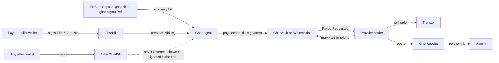

# Arkiv schema

Ghar keeps two entity types on Rabdi (chain 7794095). Both are created `readonly`, so their values can't be edited after posting. All attributes are public, so no names or account numbers go on Arkiv.

## Flow

## GharBill (`ghar_bill`)

| Column | Type | Indexed | Why |
| --- | --- | --- | --- |
| `payee` | str | yes | ENS name; the agent's main filter |
| `invoiceRef` | str | yes | Payee's own reference |
| `currency` | str | yes | ISO 4217 code of what the payee is owed |
| `dueDate` | u64 | yes | Unix seconds; open bills are `dueDate >= now` |
| `digest` | str | yes | EIP-712 digest; links the bill to the vault and the receipt |
| `amount` | u256 | no | USDT base units |
| `signature` | bytes | no | Biller's EIP-712 signature, which `pay()` requires |
| `note` | str, optional | no | Public text |

- **Owner and creator:** the biller's wallet. The agent filters with `createdBy(biller)`, where `biller` comes from ENS.
- **Expires:** 7 days after the due date, at least 1 day from posting. The vault refuses the bill after the due date; the extra week keeps it readable.

## GharReceipt (`ghar_receipt`)

| Column | Type | Indexed | Why |
| --- | --- | --- | --- |
| `digest` | str | yes | Finds the receipt for a payout |
| `billKey` | str | yes | Arkiv key of the bill |
| `payee` | str | yes | Lists a payee's receipts |
| `status` | str | yes | `paid` or `refunded` |
| `settlementTx` | str | no | Whitechain transaction |
| `providerRef` | str | no | Provider order id, or refund reason |
| `fiat` | str, optional | no | Delivered amount, for example `40.10 USD` |

- **Owner and creator:** the provider wallet. Readers filter with `createdBy(provider)`, where `provider` is read from the vault.
- **Expires:** `ExpirationTime.max()`, about 182 days. Longer retention would need a Lifetime Extension.

## What stops what

| Attack | Stopped by |
| --- | --- |
| Fake bill from another wallet | `$creator` differs from the ENS biller |
| "Pay this new account" message | The payout account is the ENS record, which only the provider's verifier can write |
| Changed amount or due date | Biller's signature, checked by the agent and again by the vault |
| Paying the same bill twice | The vault refuses a digest it has already paid |
| Fake receipt | `createdBy(provider)` |

Entity expiry only keeps the inbox clean. It isn't what prevents double payment.
